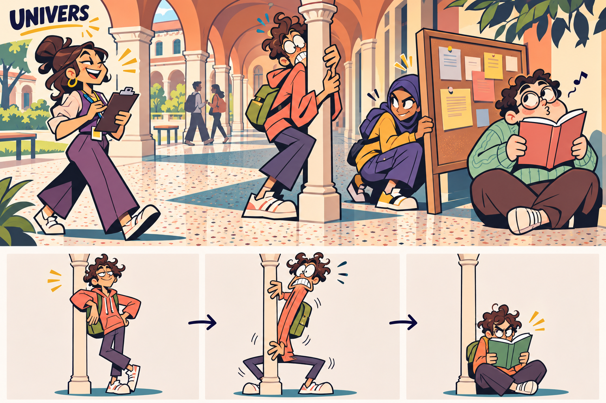

# 

Univers è un party game online da giocare nel browser. Un gruppo di studenti inventa qualsiasi passatempo pur di non seguire la lezione. La pausa tra due corsi diventa una serie di minigiochi a colpi di appelli a sorpresa, volantini inceppati e posti rubati in aula studio.

- [Meccaniche di gioco](design/meccaniche-di-gioco.md)
- [Direzione grafica e animazioni](design/direzione-grafica.md)

## Riferimento visivo

*Fuori Aula* è la tavola di riferimento per i personaggi, il campus e le animazioni. Nella fascia inferiore, uno studente passa dalla sicurezza al panico e poi finge di studiare.
