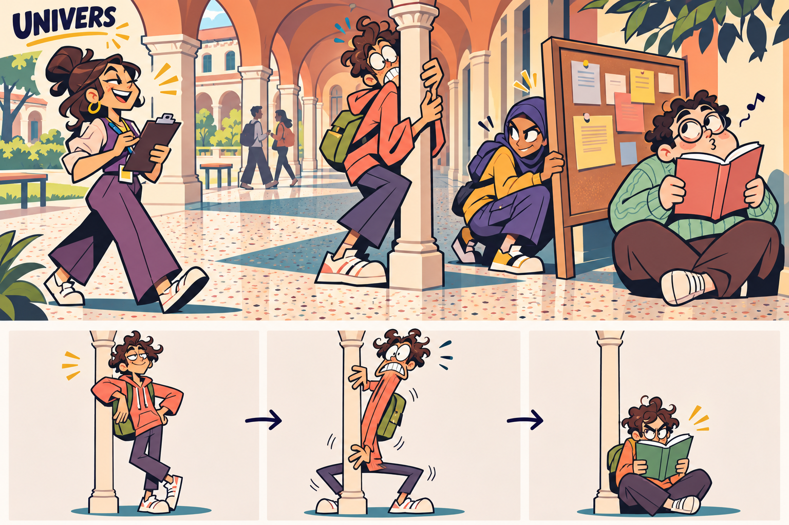
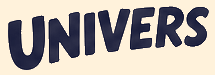

# Direzione grafica e animazioni

**Fuori Aula** è la direzione visiva di Univers. Il campus italiano è disegnato come un cartone animato 2D. Il tono viene dalle reazioni dei personaggi e da piccoli incidenti riconoscibili, come uno zaino che spunta da un nascondiglio o una stampante che sputa pagine in ritardo.

La tavola mostra un momento narrativo di **Appello a sorpresa** e tre pose del personaggio scoperto. Per la schermata giocabile, la mappa di questo minigioco deve rendere leggibili percorsi, zone selezionabili e indizi.

## Logo

Il logo è la sola scritta **UNIVERS** in maiuscolo, ripresa dalla tavola e isolata su un fondo crema. Il titolo del README usa questo file. Nel gioco il lettering blu notte va appoggiato su una superficie chiara per mantenere il contrasto.

## Personaggi e ambienti

- **Sagome riconoscibili.** Zaino grande, spalle larghe, gambe sottili o occhiali tondi distinguono gli Univers già da lontano. La forma e un accessorio identificano ciascuno anche quando due giocatori scelgono colori simili.
- **Volti espressivi.** Occhi e sopracciglia fanno capire in fretta se un Univers è convinto di avercela fatta, si accorge del guaio o tenta di sembrare innocente.
- **Contorni e colori.** Contorni blu notte, ombre a tinta piatta e forme ampie. La palette iniziale usa crema per la pietra, terracotta per i portici, verde acqua per le ombre, corallo e giallo per gli accenti. Gli accenti più saturi individuano personaggi e oggetti attivi.
- **Campus.** Portici, aula studio, biblioteca, bar e copisteria hanno pochi elementi caratteristici. I dettagli stanno ai bordi della scena, così porte, percorsi e oggetti interattivi si riconoscono anche su schermi piccoli.
- **Inquadrature.** Scene narrative a tre quarti. Visuale alta per griglie e percorsi, ripresa frontale per il proiettore, il bancone e la macchinetta. Nei round la camera resta stabile durante le azioni che richiedono precisione.

## Come animare una gag

La gag ha tre pose leggibili: **anticipazione**, **reazione** e **chiusura**. In **Appello a sorpresa**, l'Univers si appoggia alla colonna con sicurezza, si allunga di colpo quando nota il tutor e si siede con un libro per fingere di essere sempre stato lì. Un breve fermo sulla posa finale fa leggere la battuta. La reazione da scoperto parte quando l'esito è già deciso.

Le animazioni condivise coprono attesa, movimento, azione, successo ed errore. I minigiochi aggiungono almeno una reazione specifica a un oggetto o a un esito. L'effetto rimane vicino alla fonte e lascia liberi timer, punteggio e scelte disponibili. Le informazioni nascoste, come il posto occupato da uno studente in **Appello a sorpresa**, compaiono solo quando le regole le rivelano.

| Minigioco | Gag o effetto distintivo | Informazione leggibile |
| --- | --- | --- |
| Il quarto d'ora accademico | La porta si piega mentre cigola e il docente solleva un sopracciglio. | Scarto dal bersaglio e penalità. |
| Ordini fuori corso | Il vassoio oscilla quando arriva l'ultimo prodotto e si assesta alla consegna. | Ordine ricevuto, elementi mancanti e scadenza. |
| Fuga dalla biblioteca | Una ruota traballa sempre di più e la bibliotecaria alza un dito quando il carrello si ferma. | Ritmo, rumore accumulato e tempo di stop. |
| Appunti di un altro corso | Il proiettore si spegne con un colpetto e una miniatura intrusa spunta al riordino. | Ordine scelto e tempo rimasto. Le risposte si svelano al risultato. |
| Appello a sorpresa | Chi viene trovato si stira dietro una colonna e poi finge di leggere. | Zona controllata e risultato della ricerca. |
| Stampato fronte-retro | La stampante gonfia i fianchi, ingoia il foglio e lo restituisce a fisarmonica. | Capacità del vassoio e comando per liberarlo. |
| La macchinetta mangiasoldi | Il prodotto si affaccia dallo sportello e rientra quando le offerte pareggiano. | Disponibilità nella fase di anteprima ed esito dopo le offerte. |
| Posti occupati | Gli zaini rimbalzano uno dopo l'altro quando la fila è confermata. | Posto libero, provvisorio o confermato tramite forma, simbolo e colore. |
| Frisbee di dispense | Il foglio si accartoccia al blocco e si riallarga al rilancio. | Traiettoria, valore della dispensa e autore del punto. |
| Percorso alternativo | L'Univers torna sui suoi passi con una frenata esagerata quando manca una sosta. | Prossima sosta, avanzamento e traguardo valido. |

## Interfaccia nel browser

- Una schermata di introduzione mostra obiettivo, ruolo e azioni. Durante il round restano visibili soltanto i dati necessari a giocare.
- I comandi touch hanno aree ampie e distinte. Il testo accompagna le icone nei passaggi decisivi. Timer e stati usano segnali visivi oltre a eventuali suoni.
- Una preferenza per il movimento ridotto sostituisce tremolii, zoom e grandi deformazioni con pose brevi e indicatori stabili.
- Gli esiti durano abbastanza da far leggere punteggio e motivo dell'errore. Le gag più lunghe possono comparire nella schermata tra due minigiochi.

Per il primo prototipo, preparare un Univers con le pose base e la sequenza di **Appello a sorpresa**, sei miniature leggibili per **Appunti di un altro corso** e tre stati della sedia per **Posti occupati**. Questi materiali permettono di verificare silhouette, tempi comici e chiarezza degli stati con lo stesso gruppo di prove previsto nelle [meccaniche di gioco](meccaniche-di-gioco.md).
